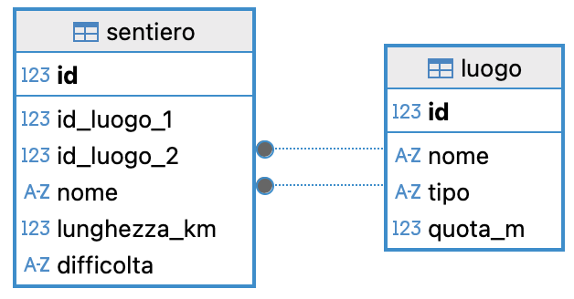

# Esercizio «Sentieri del parco»

Python · DAO/MySQL · Flet · NetworkX

Un ente vuole esplorare la rete dei sentieri di un parco naturale. Ogni luogo
(ingresso, bivio, rifugio, belvedere, ecc.) è un nodo del grafo. Due luoghi sono
collegati se esiste almeno un sentiero fra loro. I percorsi sono percorribili in
entrambi i versi: costruire un grafo semplice, non orientato e inizialmente non
pesato (`nx.Graph`). La GUI Flet è già predisposta. I dati sono inventati per
l'esercizio; non rappresentano sentieri reali.

## Avvio

1. Importare `parco_sentieri.sql` in MySQL, ad esempio usando DBeaver.
2. Creare un ambiente Python e installare le dipendenze a partire da `requirements.txt`.
3. Modificare `database/db.cnf` per la specifica connessione MySQL.
4. Avviare l'applicazione con `python main.py`.

## Base di dati

Il database contiene due tabelle:

| Tabella | Campi principali | Significato |
| --- | --- | --- |
| `luogo` | `id`, `nome`, `tipo`, `quota_m` | Una località della rete |
| `sentiero` | `id`, `id_luogo_1`, `id_luogo_2`, `nome`, `lunghezza_km`, `difficolta` | Un tratto tra due località |

Lo schema del database è mostrato nella figura seguente:

Il DAO contiene già `read_all_luoghi()`, che mostra come aprire la connessione,
eseguire una query e creare oggetti `Luogo`. Può essere utilizzata come esempio per gli altri
metodi. Per 12 coppie di luoghi il database contiene due sentieri alternativi,
con lunghezze e difficoltà proprie: nel grafo semplice ciascuna coppia
costituisce un solo arco.

La rete comprende 600 luoghi: 32 località e 568 segnavia numerati. Le quattro
componenti permettono di osservare visite con risultati differenti.

## 1. Costruzione del grafo

Completare DAO e model per inserire tutti i luoghi come nodi, inclusi quelli
isolati, e i collegamenti come archi. Sperimentare le tre strategie seguenti
una alla volta, per la costruzione del grafo in `crea_grafo()`.
Confrontare risultati e numero di query:

1. **Una query per coppia:** un doppio ciclo sulle coppie di luoghi distinti e
   una query che verifichi l'esistenza di un sentiero fra i due luoghi, in
   qualunque verso.
2. **Una query per luogo:** un ciclo sui luoghi e una query che ne restituisca
   tutti i vicini. Considerare entrambe le colonne che identificano gli estremi.
3. **Una sola query:** acquisire tutti i sentieri e aggiungere i relativi archi.
   Il metodo di lettura dei luoghi è comune alle tre strategie.

Mostrare nell'interfaccia il numero di nodi e di archi, assieme alla lista
degli archi. Per ogni strategia devono risultare gli stessi nodi e gli stessi
archi.

Con 600 luoghi, la strategia per coppie richiede `600 × 599 / 2 = 179.700`
query sui collegamenti; quella per luogo ne richiede 600, quella unica soltanto
una. A tutte va aggiunta la query iniziale sui luoghi. La prima modalità può
richiedere molto tempo: provarla dopo aver verificato le altre due.

## 2. Visita del grafo

Consentire la scelta del luogo di partenza e realizzare una visita in
profondità (DFS) ed una visita in ampiezza (BFS) del grafo.

Mostrare i luoghi raggiungibili nell'ordine di ciascuna visita, compresa la
partenza. Completare nel controller gli eventi «Crea grafo», «Visita in
profondità» e «Visita in ampiezza»: aggiornare il menu dei luoghi, visualizzare
conteggi ed elenchi e gestire la partenza non selezionata.

## Possibili estensioni

- Il grafo diventa pesato: il peso di un arco è il numero di sentieri che
  collegano i due luoghi.
- Il grafo diventa un multigrafo: se più sentieri collegano due luoghi, si
  aggiunge un arco per ciascun sentiero.
- Il multigrafo viene pesato: per ogni sentiero, il peso è la lunghezza in
  chilometri moltiplicata per un fattore di difficoltà pari a `1` per `T` e
  `1,5` per `E`.
